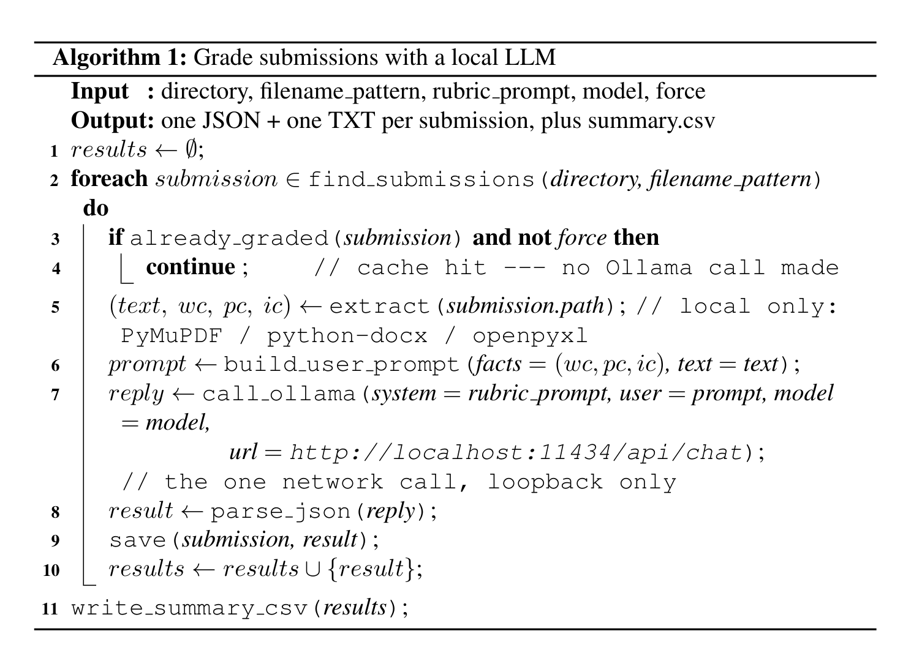

# localAdminAgent

A hands-on tutorial in confidentiality-preserving document grading: a local LLM
(Ollama + gemma4) scores internship-style reports against a rubric, packaged as three
reusable Claude Code Skills. Everything you run here operates on synthetic data —
invented students, invented companies — so you can go through the whole pipeline
without any real records anywhere near it.

This repo is a teaching version of a real pipeline used by a university internship
committee to grade Final Reports and Logbooks every semester. The core idea: since the
model runs entirely on your own machine, no submission content — not even a fragment
of it — ever leaves your computer over the network.

## Prerequisites

- Python 3.10+
- macOS, Linux, or Windows
- ~8 GB of free RAM (local LLM inference needs headroom)

## 1. Install Ollama

**macOS** — download the installer from [ollama.com](https://ollama.com), or:

```bash
brew install ollama
```

**Linux**:

```bash
curl -fsSL https://ollama.com/install.sh | sh
```

**Windows** — download `OllamaSetup.exe` from [ollama.com](https://ollama.com) and run
it. It installs as a background service with a system-tray icon — no WSL or Docker
required. The installer adds `ollama` to your PATH automatically, but you may need to
open a fresh PowerShell or Command Prompt window for that to take effect.

## 2. Verify Ollama is running

Same checks on every OS once installed and started:

```bash
ollama --version
curl http://localhost:11434
```

The `curl` command should print `Ollama is running`. On Windows, `curl` works the same
way from PowerShell (or use `Invoke-WebRequest http://localhost:11434` if you prefer).

You can also just open `http://localhost:11434` in your regular web browser — you
should see the same "Ollama is running" text. This alone is worth noticing: it's a
plain local web server on your machine, nothing more.

## 3. Pull the model

```bash
ollama pull gemma4
ollama list          # confirm gemma4 shows up
ollama run gemma4 "Say hello in one sentence."   # quick smoke test
```

## 4. Clone this repo and install Python dependencies

```bash
git clone https://github.com/HenschelLab/localAdminAgent
cd localAdminAgent
python3 -m venv .venv
source .venv/bin/activate      # Windows: .venv\Scripts\activate
pip install -r requirements.txt
```

## 5. How the pipeline is structured

Two files do the actual work:

- **`grading_common.py`** — shared plumbing: finds submissions by filename pattern,
  extracts text from PDF/DOCX/XLSX, calls the local Ollama model, parses its JSON
  reply, writes a CSV.
- **`grade_submissions.py`** — the driver. Look at the `ASSIGNMENTS` dictionary near
  the bottom of the file: each entry is one assignment type (rubric fields, the prompt
  sent to the model, which CSV columns to write). This is the extension point — adding
  a new kind of document to grade means adding one new entry here, not writing a new
  script.

A third script, **`merge_gradebook.py`**, takes the resulting scores and merges them
into a gradebook export, without ever overwriting a grade that's already there.

These three stages are documented as **Claude Code Skills** under `.claude/skills/`:

- `grade-submissions` — extraction + scoring
- `write-grading-csv` — rolling per-student results into one summary spreadsheet
- `merge-gradebook` — joining scores into a gradebook, safely

If you're using Claude Code, these Skills are what let you (or an agent) pick this
pipeline back up next semester without re-explaining the rubric, the safeguards, or
the output format from scratch.

### The core loop, in pseudocode

Stripped down to the shape that matters — one local LLM call per submission, nothing
else leaving the machine:



Typeset with LaTeX (`algorithm2e`); source at
[`docs/pseudocode.tex`](docs/pseudocode.tex) if you want to edit or recompile it
(`pdflatex pseudocode.tex`, then rasterize the PDF to update the PNG).

The real version is `grade_submissions.py` + `grading_common.py` — this is just the
shape of it, with the extraction/caching/error-handling details stripped out.

## 6. Where the rubric lives

Open `example_course_layout/FinalReports/CLAUDE.md`. This is the **layered-CLAUDE.md
pattern**: the grading rubric lives as a plain file inside the directory being graded,
not baked into the code. `grade_submissions.py`'s `"report"` and `"practice"` entries
use a rubric written in this same spirit — read it alongside the CLAUDE.md file to see
how a rubric on disk becomes a prompt in code.

`example_course_layout/` itself is illustrative only — it shows *where* a rubric file
would sit relative to real submissions, without any submissions actually being there.

## 7. Hands-on Exercise 1: write your own rubric

Open [`Workshop_Exercise/Exercise_1_write_a_rubric.md`](Workshop_Exercise/Exercise_1_write_a_rubric.md).
You'll write a small rubric of your own, run it against four synthetic practice
reports, and compare your results to an instructor answer key. ~30–40 minutes.

## 8. Hands-on Exercise 2 (bonus): merge into a gradebook

Open [`Workshop_Exercise/Exercise_2_merge_gradebook.md`](Workshop_Exercise/Exercise_2_merge_gradebook.md).
Takes the scores from Exercise 1 and merges them into a synthetic gradebook export,
including a deliberate demonstration of the "never overwrite an existing grade"
safeguard. ~15 minutes.

## Human judgment, kept in the loop

This pipeline is deliberately **not** a fully automated grader. The model's job is to
extract evidence and propose a score; several points in the pipeline exist specifically
to stop and hand the actual decision to a person instead of guessing:

- A gradebook cell is only auto-filled when it's blank or `"Needs Grading"`. Anything
  else — a grade already entered, a manual override — is left completely untouched;
  the AI's own score is still recorded, but only as an advisory note for a human to
  weigh, never as a silent replacement.
- A student with more than one graded file for the same assignment is flagged as
  **ambiguous** rather than having one file picked for them automatically.
- A 0-word extraction is flagged as "likely an unreadable scanned PDF," not scored as
  an empty submission — only a human opening the actual file can tell the difference,
  so the pipeline doesn't pretend to.
- `--extra-review-json` exists so an instructor can attach a known-bad-match note
  (e.g. the wrong document type entirely) to the output as a flag for review, rather
  than the script silently deciding what to do about it.

Where a case is routine, the pipeline moves fast. Where it's ambiguous, risky, or
simply outside what the rubric can settle on its own, it's built to say so and stop —
Exercise 2 walks through watching that safeguard fire on purpose.

## Confidentiality, by construction

A real deployment of this pipeline never sends submission content anywhere but
`http://localhost:11434` — Ollama's own local HTTP server, bound to the loopback
address, which never reaches a network card, router, or ISP. The only time the
network is used at all is the one-time `ollama pull` of the model itself, before any
document exists to grade.

This repo deliberately does **not** include the real, in-production gradebook-merge
script this tutorial's `merge_gradebook.py` is based on — that script hardcodes real
student identifiers and semester-specific notes, which have no place in a public
tutorial. `merge_gradebook.py` here is a from-scratch, generic rewrite: every path is
a command-line argument, and known-bad-match notes come from an optional JSON file you
supply yourself, never from values baked into the script.

## License

No license is granted; all rights reserved. This is internal teaching material, not
intended for redistribution.
